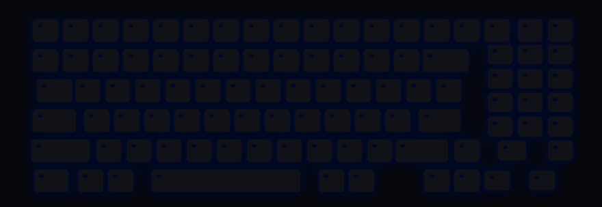
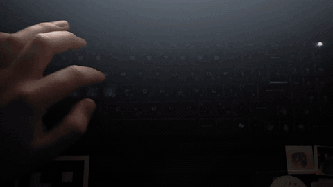

# msi-kb-ripple 💧

**Every keystroke drops a stone into your keyboard.** Rings spread from the key you pressed and fade out like water.

For MSI laptops with the 24-zone *MysticLight MS-1603* backlight (built on a Sword 17 HX B13V). No MSI Center needed: about 250 lines of Python talking HID directly.

<p align="center">
  <br>
  <sub>Simulated typing, rendered by the same engine that drives the LEDs (<code>tools/make_demo.py</code>)</sub>
</p>

<p align="center">
  <a href="docs/real.mp4"></a><br>
  <sub>The real thing. Click for the full video.</sub>
</p>

## Install

```powershell
git clone <this repo> msi-kb-ripple
cd msi-kb-ripple
powershell -ExecutionPolicy Bypass -File install.ps1
```

The installer pip-installs `hidapi`, checks for the `1462:1603` controller, adds a Startup shortcut and starts the effect in the background. Then just type.

| | |
|---|---|
| Hands-off demo | `python ripple.py --demo` |
| Stop | `stop-ripple.cmd` |
| Remove completely | `powershell -ExecutionPolicy Bypass -File uninstall.ps1` |

## Tune it

Edit the top of [`ripple.py`](ripple.py), then stop and start the effect again.

| Knob | Does |
|---|---|
| `SPEED` | How fast rings spread, in keys per second |
| `TAIL` | Length of the glow behind the ring |
| `LIFE` | How long a drop lives, in seconds |
| `GAIN` | Ring brightness |
| `BG` | Colour of calm water |
| `RELEASE` | How quickly zones go dark. Higher is crisper, lower is dreamier. |

## How it works

* A low-level keyboard hook turns each key press into an *(x, y)* position on the keyboard. Keys are never logged or stored.
* A ring with a sharp front and a soft wake is evaluated at the centre of each of the 24 LED zones ([zone map](docs/zones.md)). The result is smoothed over time (fast attack, quick release), so nothing flickers.
* Only zones whose colour changed get written, about 0.8 ms each, at roughly 45 fps.

The controller has 24 zones, not per-key LEDs. Older docs describe it as 4 zones; on this model it's 24.

## Safety

Only two packets are ever sent: *zone select* and *mode/colour* on feature report 2. Both come from [OpenRGB](https://gitlab.com/CalcProgrammer1/OpenRGB) and [LightShow](https://github.com/th3r00t/lightshow). The controller exposes report IDs 3–8 too, but they are deliberately left alone, because a malformed packet has [bricked a similar MSI backlight](https://github.com/Askannz/msi-perkeyrgb/issues/24). Use at your own risk.

🤖 Setting this up with an AI agent? Point it at [AGENTS.md](AGENTS.md).
