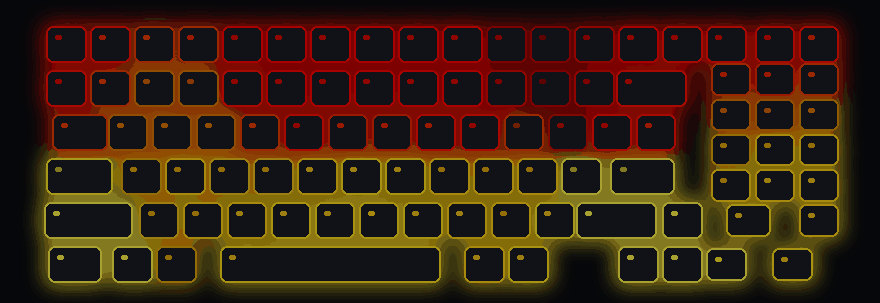

# msi-kb-ripple 💧

**Every keystroke drops a stone into your keyboard.** Rings spread from the key you pressed and fade out like water.

For MSI laptops with the 24-zone *MysticLight MS-1603* backlight (built on a Sword 17 HX B13V). No MSI Center needed: under 400 lines of Python talking HID directly.

<p align="center">
  <br>
  <sub>Simulated typing, rendered by the same engine that drives the LEDs (<code>tools/make_demo.py</code>)</sub>
</p>

<p align="center">
  <a href="docs/real.mp4"></a><br>
  <sub>The real thing. Click for the full video.</sub>
</p>

### 🔥 Also: hearth fire

Coals glow along the bottom rows, red tongues lick upward, sparks drift to the top. **Typing stokes the fire**: each press feeds it and flares up where you hit.

<p align="center">
  
</p>

## Install

```powershell
git clone https://github.com/GeBondar/msi-kb-ripple
cd msi-kb-ripple
powershell -ExecutionPolicy Bypass -File install.ps1
```

The installer pip-installs `hidapi`, checks for the `1462:1603` controller, adds a Startup shortcut and starts the effect in the background. Then just type.

| | |
|---|---|
| Fire instead of water | `install.ps1 -Effect fire` (run it again with `-Effect ripple` to switch back) |
| Try without installing | `python ripple.py` · `python fire.py` |
| Hands-off demo | `python ripple.py --demo` · `python fire.py --calm` |
| Stop | `stop-ripple.cmd` (stops either effect) |
| Remove completely | `powershell -ExecutionPolicy Bypass -File uninstall.ps1` |

Only one effect can drive the LEDs at a time. A second copy just says so and exits.

## Tune it

Edit the knobs at the top of the script, then stop and start the effect again.

| 💧 [`ripple.py`](ripple.py) | Does | 🔥 [`fire.py`](fire.py) | Does |
|---|---|---|---|
| `SPEED` | Ring speed, keys/s | `FLAME` | Flame height |
| `TAIL` | Glow behind the ring | `LICK` · `SWAY` | Tongue size · speed |
| `LIFE` | Drop lifetime, s | `GUST` | Slow whole-fire surges |
| `GAIN` | Brightness | `SPARKS` | Sparks per second |
| `BG` | Calm-water colour | `HEAT` | Up = more yellow, down = more red |
| `RELEASE` | Fade speed: crisp ↔ dreamy | `STOKE` | How much typing feeds the fire |

Looks dim? The laptop's own backlight level caps everything. Press **Fn + F10** to raise it.

## How it works

* A low-level keyboard hook turns each key press into an *(x, y)* position on the keyboard. Keys are never logged or stored.
* Each effect is a function of *(x, y, time)*, evaluated at the centre of each of the 24 LED zones ([zone map](docs/zones.md)). Water is a ring with a sharp front and a soft wake. Fire is a heat field: a few drifting sine waves for the tongues, run through a red → yellow colour ramp.
* Colours are smoothed over time (fast attack, quick release), so nothing flickers.
* Only zones whose colour changed get written, about 0.8 ms each, at roughly 45 fps.

The controller has 24 zones, not per-key LEDs. Older docs describe it as 4 zones; on this model it's 24.

## Safety

Only two packets are ever sent: *zone select* and *mode/colour* on feature report 2. Both come from [OpenRGB](https://gitlab.com/CalcProgrammer1/OpenRGB) and [LightShow](https://github.com/th3r00t/lightshow). The controller exposes report IDs 3–8 too, but they are deliberately left alone, because a malformed packet has [bricked a similar MSI backlight](https://github.com/Askannz/msi-perkeyrgb/issues/24). Use at your own risk.

🤖 Setting this up with an AI agent? Point it at [AGENTS.md](AGENTS.md).

MIT licensed, see [LICENSE](LICENSE).
